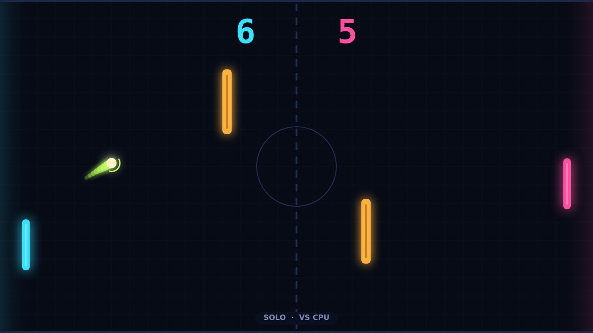

# Carom

Carom is a paddle duel on a dark, glowing field. You hold the left paddle and
your opponent holds the right, either the CPU in Solo or a friend on the same
keyboard in Versus. Two amber pillars stand in the middle of the court. They
block the straight lines between the paddles, so a rally rarely runs the same
way twice.

Every point opens with the ball parked at center court. A ring around it winds
down while you set your paddle, and an arrow shows which way the serve will go.
The ball always serves toward whoever just lost the point. Each paddle hit
adds a little pace, so a long rally starts lazy and ends in a blur. Hit the
ball off the middle of your paddle and it goes back flat. Catch it near an end
and it flies out at a steep angle, toward a wall or a pillar.

Spin is where Carom comes alive. Move your paddle as the ball arrives and the
return curls the way you were moving: swing down and it bends clockwise, swing
up and it bends the other way. A lime trail and a ring around the ball show how
hard it is curling. Spin fades over a second or so but carries through every
bounce. A curled ball can hook around a pillar, glance off a wall at a strange
angle, or dip behind a paddle that thought it was in position.

Matches go to 11, and you have to win by two, so a close game can run long at
10–10 as both players trade bank shots and bent returns. Win it and the field
dims to announce the winner and the final score, and one keypress starts the
rematch.
